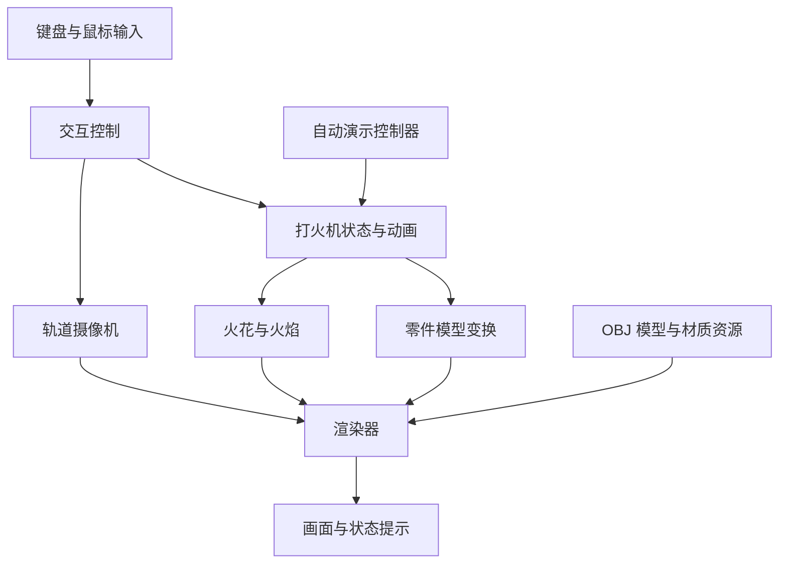
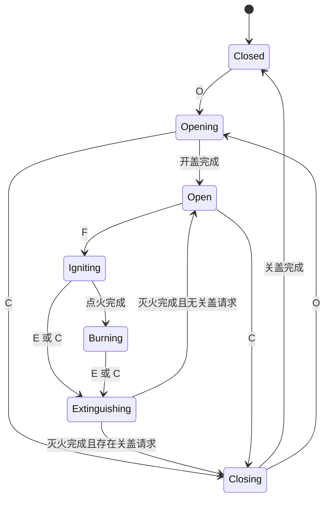

# Lighter3D · 经典翻盖式打火机三维建模与交互仿真系统设计文档

**项目名称：** 基于 OpenGL 的经典翻盖式打火机三维建模与交互仿真系统  
**英文名称：** 3D Flip-Top Lighter Simulation System Based on OpenGL  
**项目简称：** Lighter3D  
**文档版本：** V1.0  
**文档性质：** 开发设计与验收依据；本文描述计划实现的功能，不代表功能已经完成。  
**确定的技术路线：** Blender 建模并导出 OBJ，使用 C++17 与 OpenGL 3.3 Core 开发，采用 VS Code、CMake 和 MSVC 构建，模型精细程度为中等。

---

## 1. 项目概述

### 1.1 项目背景

本项目以 Zippo 经典翻盖式打火机为造型参考，开发一个能够展示三维模型、机械动作、点火过程和动态火焰的交互程序。

与静态物体展示相比，翻盖式打火机包含独立活动部件和连续动作过程，适合用于综合实践层次建模、矩阵变换、动画状态机、粒子系统、光照材质以及鼠标交互等计算机图形学知识。

### 1.2 项目目标

使用 Blender 制作结构清晰、比例协调的中等精细度模型，由 OpenGL 加载与渲染，实现以下目标：

1. 展示打火机机身、上盖、内胆、防风罩、铰链和打火轮。
2. 实现上盖沿真实连接位置平滑开启与关闭。
3. 实现打火轮旋转、火花出现和火焰点燃的连续动画。
4. 实现持续摇曳的火焰、手动灭火和合盖前自动灭火。
5. 支持鼠标水平 360° 环绕、俯仰观察和滚轮缩放。
6. 支持键盘操作、完整自动演示以及一键重置。
7. 通过金属材质、光照和简洁的操作提示形成适合课程展示的产品观察窗口。

### 1.3 设计原则

- **结构优先：** 保证零件位置、连接关系和旋转轴正确。
- **动作连贯：** 使用时间驱动的插值动画，避免按键触发后瞬间跳变。
- **状态明确：** 所有动作由统一状态机协调，避免闭盖燃烧、重复点火等异常。
- **模块独立：** 将模型加载、动画、摄像机、特效和渲染分别管理。
- **范围可控：** 重点完成外形、机械动作、金属质感和火焰效果，不进行工业级机械仿真或流体模拟。

## 2. 项目范围与功能需求

### 2.1 功能范围

| 编号 | 功能 | 需求说明 | 优先级 |
| --- | --- | --- | --- |
| FR-01 | 三维模型展示 | 正确显示机身、上盖、内胆、防风罩、铰链和打火轮 | 必须 |
| FR-02 | 开盖动画 | 按 O 后，上盖绕铰链轴平滑旋转至约 115° | 必须 |
| FR-03 | 关盖动画 | 按 C 后，上盖回到闭合位置；燃烧时先灭火 | 必须 |
| FR-04 | 打火轮动画 | 按 F 后，打火轮绕自身轴快速转动 | 必须 |
| FR-05 | 点火与灭火 | 支持点火、按 E 灭火和合盖自动灭火 | 必须 |
| FR-06 | 动态火焰 | 实现渐变颜色、点燃生长、持续摇曳和熄灭收缩 | 必须 |
| FR-07 | 环绕观察 | 按住鼠标左键拖动，改变水平角和俯仰角 | 必须 |
| FR-08 | 视角缩放 | 滚轮调整摄像机与观察中心的距离 | 必须 |
| FR-09 | 重置 | 按 R 立即恢复模型、动画、特效和摄像机初始状态 | 必须 |
| FR-10 | 金属材质 | 使用 Blinn-Phong 光照表现外壳和机械部件的材质差异 | 必须 |
| FR-11 | 火花粒子 | 点火过程中短暂产生火花 | 推荐，纳入计划交付 |
| FR-12 | 自动演示 | 按 Space 播放完整开盖、点火、灭火和关盖流程 | 推荐，纳入计划交付 |
| FR-13 | 状态与操作提示 | 显示当前状态、操作说明及非法操作提示 | 必须 |
| FR-14 | 观察中心平移 | 按住鼠标右键拖动平移观察中心 | 可选 |
| FR-15 | 烟雾与投影 | 增加灭火烟雾或简化地面投影 | 可选 |

### 2.2 不纳入本期的内容

- 燃料消耗、热传导、燃烧化学过程和真实流体火焰。
- 完整火石进给机构、弹簧受力及零件碰撞求解。
- 复杂 PBR 材质、实时环境反射和全局光照。
- 高精度工业尺寸复刻。

### 2.3 运行与质量要求

- 目标平台为 Windows，开发环境为 VS Code + CMake + MSVC。
- 图形环境须支持 OpenGL 3.3 Core。
- 动画以秒为单位推进，在不同帧率下保持基本一致的动作时长。
- 摄像机交互与模型动画独立，可在开盖、点火和燃烧过程中同时操作视角。
- 窗口尺寸变化时更新视口和投影比例，避免模型被拉伸。
- 资源缺失、Shader 编译失败或模型加载失败时，输出明确错误信息。
- 性能以目标演示电脑实测为准；建议以 1920 × 1080 分辨率下接近 60 FPS 为优化目标，不作为未经测试的性能承诺。

## 3. 总体架构

### 3.1 系统模块

| 模块 | 主要职责 | 主要组成 |
| --- | --- | --- |
| 三维建模与资源模块 | 制作、导出、加载和管理模型及材质 | Blender、OBJ、Model、Mesh |
| 动画控制模块 | 管理状态转换、开合角度和打火时序 | Lighter、Animation、LighterState |
| 火焰特效模块 | 生成火花，控制火焰形态与透明度 | ParticleSystem、火焰网格、GLSL |
| 摄像机模块 | 环绕、缩放、可选平移及视角重置 | Camera |
| 渲染模块 | 设置光照、材质，组织不透明和透明对象绘制 | Renderer、Shader |
| 交互控制模块 | 处理输入、自动演示和状态提示 | InputController、DemoController |

### 3.2 模块协作关系



交互层向打火机对象发送动作请求，状态机判断请求是否合法。动画模块根据时间更新零件角度和火焰比例，渲染器读取结果并绘制。摄像机只改变观察方式，不修改打火机状态。

## 4. 技术选型

| 技术项 | 选定方案 | 用途 |
| --- | --- | --- |
| 编程语言 | C++17 | 实现系统逻辑与渲染流程 |
| 图形接口 | OpenGL 3.3 Core | 三维绘制 |
| Shader 语言 | GLSL 330 | 光照、材质与动态火焰 |
| 开发工具 | VS Code | 编辑、构建任务与调试 |
| 编译工具链 | MSVC | 编译和链接 C++ 程序 |
| 构建系统 | CMake | 管理目标、依赖与资源复制 |
| 建模工具 | Blender | 制作主体与机械零件模型 |
| 模型格式 | OBJ，按需附带 MTL | 交换静态网格与基础材质信息 |
| 窗口与输入 | GLFW | 创建窗口、上下文和处理输入 |
| OpenGL 函数加载 | GLAD | 加载 OpenGL 函数 |
| 数学库 | GLM | 向量、矩阵和摄像机变换 |
| 模型导入 | Assimp | 读取 OBJ 并转换为网格资源 |
| 图片加载 | stb_image | 加载可选金属纹理 |
| 操作面板 | Dear ImGui，可选 | 显示按钮、状态和参数 |

不引入 Dear ImGui 时，可通过窗口标题、控制台和简易屏幕提示提供操作信息。具体依赖版本在环境配置阶段确定并固定，确保项目可以重复构建。

## 5. 三维模型设计

### 5.1 建模路线与精细程度

采用 **Blender 建模 → 分部件导出 OBJ → Assimp 导入 → OpenGL 渲染与动画** 的流程。

模型达到中等精细程度：外壳和上盖具有倒角，内胆、防风罩、铰链、打火轮和支架可辨认，能够从常用展示角度观察内部结构。主要机械零件统一在 Blender 中制作；程序负责零件装配、运动及火花和火焰特效。

### 5.2 零件划分

| 部件 | 建模要求 | 运动方式 |
| --- | --- | --- |
| 外壳机身 | 圆角矩形金属外壳，保留顶部开口和适当壁厚 | 固定 |
| 上盖 | 与机身轮廓匹配的中空壳体，闭合时形成清晰接缝 | 绕铰链轴旋转 |
| 内胆 | 位于机身内部，上部在开盖后可见 | 固定 |
| 防风罩 | 薄壁金属罩，具有可见通风孔和顶部开口 | 固定 |
| 固定铰链节 | 与机身连接的圆柱形铰链节和转轴 | 固定 |
| 活动铰链节 | 与上盖连接，和固定铰链节交错装配 | 随上盖旋转 |
| 打火轮 | 带齿纹的圆柱体，侧面和轮缘结构可辨认 | 绕自身中心轴旋转 |
| 打火轮支架 | 两侧支承结构，不遮挡轮缘 | 固定 |
| 火石区域 | 简化圆柱或支承结构 | 固定 |
| 灯芯 | 位于防风罩内部，作为火焰根部定位点 | 固定 |
| 火焰 | 程序生成的分层网格 | 缩放、摇曳和颜色变化 |

防风罩孔洞在 Blender 中制作实际几何开口，可使用布尔操作后清理拓扑。深色圆片只能表现孔洞外观，不能形成真实通孔，不作为最终模型的首选实现。

### 5.3 坐标与装配约定

为避免模型导入后轴向、尺寸和动画中心不一致，约定如下：

- 程序使用右手坐标系，Y 轴向上，X 轴表示机身左右，Z 轴表示机身前后。
- 机身正面朝向 +Z，模型装配原点设在闭合打火机的整体中心附近。
- Blender 导出时统一转换轴向与缩放；先用一个测试零件确认导入后的方向。
- 在程序中将闭合模型总高度统一为约 3.0 个场景单位；该数值用于场景布局，不代表实际尺寸。
- 所有零件沿用同一套装配坐标导出，不单独居中，不分别归一化尺寸。
- 铰链放置在机身侧缘的连接位置，以最终 Blender 模型为准。旋转轴沿铰链圆柱中心线确定，避免用笼统的“后侧”描述代替实际轴线。
- 打火轮中心、打火轮轴向、铰链轴心和灯芯位置记录在装配配置中，使用与导入模型一致的坐标。

### 5.4 模型导出规范

1. 零件使用清晰稳定的名称，例如 `body`、`lid`、`hinge_fixed`、`hinge_lid`、`wheel`。
2. 应用必要的旋转与缩放，确认所有零件共享统一的装配坐标。
3. 应用倒角等需要保留的修改器，检查法线和面朝向。
4. 对导出网格进行三角化，检查细长三角形、重叠面和明显破面。
5. 为倒角区域设置平滑法线，为必要的硬边保留清晰边界。
6. 如使用纹理，完成 UV 展开，并使用项目内的相对资源路径。
7. 按零件分别导出 OBJ，检查导入后能否在零位姿准确装配。
8. 保存 Blender 源文件，便于修改模型和重新导出。

**OBJ 不负责保存动画层级和可靠的机械枢轴信息。** 零件父子关系、铰链轴心和打火轮轴心由 C++ 装配逻辑或配置文件明确保存，不依赖 Blender 对象原点在 OBJ 中自动还原。

### 5.5 零件层级

```text
LighterRoot
├── Body
├── Insert
├── Chimney
├── HingeFixed
├── WheelSupports
├── Flint
├── Wick
├── LidAssembly           ← 绕铰链轴旋转
│   ├── Lid
│   └── HingeLid
├── WheelAssembly         ← 绕打火轮中心轴旋转
│   └── Wheel
└── FlameAnchor           ← 固定在灯芯位置
    └── Flame
```

## 6. 机械变换与动画设计

### 6.1 上盖绕铰链旋转

上盖必须绕铰链轴旋转，不能绕上盖几何中心旋转。采用列向量约定，其模型矩阵为：

$$
M_{lid}=M_{root}\,T(p_h)\,R(a_h,\theta)\,T(-p_h)\,M_{bind}
$$

其中：

- $M_{root}$：打火机整体在世界中的变换。
- $p_h$：铰链轴心在装配坐标中的位置。
- $a_h$：归一化后的铰链轴方向。
- $\theta$：当前开盖角度。
- $M_{bind}$：从零件局部坐标到闭合装配位置的变换。

若 OBJ 顶点已经使用统一的装配坐标，则 $M_{bind}$ 可取单位矩阵，避免重复平移。活动铰链节与上盖使用相同的旋转变换；固定铰链节保持不动。

### 6.2 时间插值

使用平滑插值函数：

$$
u=\operatorname{clamp}\left(\frac{t}{D},0,1\right),\qquad s(u)=3u^2-2u^3
$$

$$
v(t)=v_0+(v_1-v_0)s(u)
$$

其中 $t$ 为动画已经运行的时间，$D$ 为动画时长，$v_0$ 与 $v_1$ 分别为起点和终点。动画进度由独立对象管理，不通过角度是否接近某值来猜测动画是否完成。

### 6.3 动画参数

| 动画 | 起点 | 终点 | 建议时长 |
| --- | --- | --- | --- |
| 开盖 | 当前角度 | 115° | 完整行程约 0.5 秒 |
| 关盖 | 当前角度 | 0° | 完整行程约 0.5 秒 |
| 点火 | 火焰比例 0 | 火焰比例 1 | 约 0.4 秒 |
| 灭火 | 当前火焰比例 | 0 | 约 0.3 秒 |

开盖角度可在 110°～120° 范围内调整，以模型无明显穿插且展示效果良好为准。运动中反向操作时，从当前角度开始新插值，按剩余行程调整时长，保证位置连续。

### 6.4 打火轮旋转

打火轮采用与上盖相同的枢轴变换方式，但轴心使用打火轮中心，旋转轴使用轮轴方向。基本角度更新为：

$$
\theta_w(t)=\theta_{w0}+\omega t
$$

动画只在点火阶段触发，结束后保持当前角度。轮齿随网格整体旋转，支架保持静止。

## 7. 状态机与动作控制

### 7.1 状态定义

```cpp
enum class LighterState {
    Closed,
    Opening,
    Open,
    Igniting,
    Burning,
    Extinguishing,
    Closing
};
```

| 状态 | 含义 | 主要约束 |
| --- | --- | --- |
| Closed | 上盖闭合 | 火焰比例为 0，无点火粒子 |
| Opening | 上盖正在打开 | 不接受点火请求 |
| Open | 上盖完全打开，火焰熄灭 | 可以点火或关盖 |
| Igniting | 打火轮旋转、产生火花并点燃火焰 | 上盖保持打开 |
| Burning | 火焰持续燃烧 | 上盖保持打开 |
| Extinguishing | 火焰逐渐缩小、变暗和消失 | 不再生成火花 |
| Closing | 上盖正在关闭 | 火焰必须已熄灭 |

### 7.2 状态转换



按 R 时，任意状态均立即回到 `Closed`，同时清理动画、粒子、演示进度并重置摄像机；为保持图示简洁，该全局转换未逐一画出。

### 7.3 输入处理规则

| 当前状态 | 输入 | 处理方式 |
| --- | --- | --- |
| Closed | O | 开始开盖 |
| Closed | F | 忽略，提示“请先打开上盖” |
| Opening | F | 忽略，提示“请等待开盖完成” |
| Opening | C | 从当前角度反向关盖 |
| Open | F | 开始点火 |
| Open | C | 开始关盖 |
| Igniting | F | 忽略重复点火 |
| Igniting | E | 取消后续点火事件，按当前火焰比例灭火 |
| Igniting | C | 取消后续点火事件，灭火后关盖 |
| Burning | F | 忽略重复点火 |
| Burning | E | 灭火后保持打开 |
| Burning | C | 灭火后关盖 |
| Extinguishing | C | 记录关盖请求，灭火完成后关盖 |
| Extinguishing | O | 取消待执行的关盖请求，灭火后保持打开 |
| Extinguishing | F | 忽略，等待灭火完成 |
| Closing | O | 从当前角度反向开盖 |
| Closing | F | 忽略，提示“请先打开上盖” |
| 任意状态 | R | 立即重置整个系统 |

未列出的重复或无效操作不改变状态。O、C、F、E、R 和 Space 采用按下沿触发，忽略长按产生的自动重复事件。

### 7.4 合盖前灭火

使用 `closeAfterExtinguish` 标志记录灭火后的动作：

1. 在点火或燃烧状态收到 C，设置关盖请求。
2. 停止产生新火花，取消尚未触发的点火事件。
3. 从当前火焰比例开始熄灭动画。
4. 火焰归零并清理剩余火花后，进入 `Closing`。
5. 上盖到达 0° 后，进入 `Closed`。

火焰已经为零时可跳过无意义的灭火等待。整个流程须保持“只有火焰熄灭后才能开始关盖”的约束。

## 8. 火花与火焰设计

### 8.1 点火时间线

点火过程总时长建议为 0.4 秒，内部按时间组织连续事件：

| 时间区间 | 动作 |
| --- | --- |
| 0.00～0.18 秒 | 打火轮快速转动 |
| 约 0.08 秒 | 在轮缘与火石接触区域触发一次火花爆发 |
| 0.15～0.40 秒 | 火焰从小到大增长 |
| 0.40 秒后 | 进入持续燃烧状态 |

火花应先于明显火焰出现。事件依据“本次更新时间跨过事件时刻”触发，不能依赖时间恰好等于某个值，以免低帧率时遗漏。

### 8.2 火花粒子

```cpp
struct Spark {
    glm::vec3 position;
    glm::vec3 velocity;
    float life;
    float maxLife;
};
```

火花从打火轮附近向灯芯方向及上方散开，使用随机初速度和短生命周期形成自然变化。运动可采用：

$$
v_{t+\Delta t}=v_t+g\Delta t
$$

$$
p_{t+\Delta t}=p_t+v_t\Delta t+\frac{1}{2}g\Delta t^2
$$

其中 $g$ 为向下的重力加速度向量。粒子随生命周期降低透明度和尺寸，生命周期结束后回收。使用固定容量粒子池，避免持续创建对象造成资源增长。

### 8.3 火焰网格与颜色

火焰使用程序生成的分层三维网格，不进行流体计算。沿高度生成若干截面，根部收束在灯芯处，中下部较宽，顶部逐渐收尖；使用内外层网格表现亮芯和外焰。

| 区域 | 建议颜色与表现 |
| --- | --- |
| 根部 | 淡蓝色，小范围低透明度渐变 |
| 内层 | 浅黄至黄白色，亮度较高 |
| 外层 | 黄色至橙色，半透明 |
| 顶端 | 深橙色并逐渐降低透明度 |

### 8.4 火焰摇曳

设 $h\in[0,1]$ 为归一化高度，可使用如下偏移：

$$
x'=x+A h^2\sin(\omega t+kh)
$$

$$
z'=z+B h^2\sin(\omega' t+k'h+\phi)
$$

通过高度权重 $h^2$ 让根部基本固定、顶部摆动明显。另加入小幅高度变化，避免火焰呈现完全重复的刚性摆动。时间和整体火焰比例通过 uniform 传入 Shader。

### 8.5 灭火表现

灭火过程在约 0.3 秒内完成：

1. 停止新的点火事件和火花生成。
2. 从当前火焰比例逐渐缩小高度与宽度。
3. 同时降低颜色强度和透明度。
4. 在动画结束时将火焰比例准确设为 0，避免残留微小火焰。

## 9. 摄像机与交互设计

### 9.1 鼠标和键盘映射

| 输入 | 功能 |
| --- | --- |
| O | 打开上盖 |
| C | 关闭上盖，必要时先灭火 |
| F | 点火 |
| E | 灭火，保持上盖打开 |
| R | 恢复初始状态和默认视角 |
| Space | 启动或停止自动演示 |
| 鼠标左键拖动 | 环绕旋转视角 |
| 鼠标滚轮向上 | 拉近观察 |
| 鼠标滚轮向下 | 拉远观察 |
| 鼠标右键拖动 | 平移观察中心，可选 |

### 9.2 轨道摄像机

摄像机围绕观察中心 `target` 运动，使用偏航角 `yaw`、俯仰角 `pitch` 和距离 `distance` 表示位置：

$$
p_{camera}=p_{target}+\begin{bmatrix}
d\cos(pitch)\sin(yaw)\\
d\sin(pitch)\\
d\cos(pitch)\cos(yaw)
\end{bmatrix}
$$

由以下方式生成观察矩阵：

```cpp
glm::lookAt(cameraPosition, target, glm::vec3(0.0f, 1.0f, 0.0f));
```

建议参数如下：

| 参数 | 初始约定 |
| --- | --- |
| yaw | 支持水平连续旋转，内部可周期归一化 |
| pitch | 限制为 -80°～80° |
| distance | 初始调节范围 2.5～10.0 个场景单位 |
| 默认视角 | 略带俯视的前侧视角，可同时看到正面与侧面 |
| 观察中心 | 以机身中上部为基准，兼顾打开后的上盖与火焰 |

距离范围需结合最终模型包围体、视场角和裁剪面校准；2.5 为初始建议值，若造成穿入模型则应提高最小距离。俯仰限制允许从上下方观察，但不支持跨越极点翻转摄像机。

### 9.3 交互细节

- 鼠标按下时记录当前位置，避免首次拖动跳变。
- 缩放距离必须限制在有效范围内。
- 窗口失去焦点时清理拖动状态，避免恢复焦点后视角异常。
- 若使用 Dear ImGui，鼠标或键盘被面板捕获时，不同时触发场景操作。
- 摄像机操作不打断自动演示，用户可在演示期间自由观察。

## 10. 渲染与材质设计

### 10.1 材质配置

| 部件 | 材质风格 | 渲染重点 |
| --- | --- | --- |
| 外壳与上盖 | 抛光银色金属 | 较强镜面高光，倒角处有连续明暗变化 |
| 内胆与防风罩 | 拉丝不锈钢 | 高光较柔和，可辅以细纹理 |
| 铰链 | 较深的金属 | 突出节段和连接位置 |
| 打火轮 | 深灰色金属 | 通过真实齿纹几何强化结构 |
| 灯芯 | 浅色纤维或使用后的深色端部 | 与金属形成材质区分 |
| 火焰 | 自发光、半透明 | 不受普通金属光照模型控制 |

Blinn-Phong 用于实现可控的金属高光观感，不模拟完整的镜面环境反射。外壳与上盖共享材质参数，避免闭合时出现不一致的颜色。

### 10.2 光照配置

- **主方向光：** 从前上方照亮模型，突出整体体积。
- **辅助点光源：** 从侧后方形成轮廓与金属高光。
- **环境项：** 保留暗部可见性，避免内部结构完全变黑。
- **可选火焰点光源：** 随火焰比例变化，在防风罩附近提供局部暖光。

火焰自发光只影响火焰自身的显示；若需要火焰照亮周围金属，必须单独加入光源计算。

### 10.3 Blinn-Phong 模型

$$
I=I_a k_a+I_l k_d\max(0,N\cdot L)+I_l k_s\max(0,N\cdot H)^n
$$

其中 $H=\operatorname{normalize}(L+V)$，$N$ 为表面法线，$L$ 为指向光源的方向，$V$ 为指向观察者的方向，$n$ 控制高光集中程度。所有方向应在同一坐标空间内计算，法线通过正确的法线矩阵变换。

### 10.4 绘制顺序与透明处理

1. 清理颜色和深度缓冲。
2. 绘制背景及可选展示底座。
3. 开启深度测试和深度写入，绘制所有不透明模型。
4. 保留深度测试，关闭深度写入，绘制透明火焰与火花。
5. 火焰采用透明度混合，并根据层次与观察方向处理绘制顺序；火花可使用加法混合。
6. 恢复深度写入和混合状态，绘制操作提示或 GUI。

透明效果需从多个视角检查，防止出现前后遮挡错误。实时阴影不作为首版必需功能，可在主要效果稳定后补充。

## 11. 程序结构与核心接口

### 11.1 目录结构

```text
Lighter3D/
├── CMakeLists.txt
├── CMakePresets.json
├── README.md
├── .vscode/
│   ├── extensions.json
│   └── launch.json
├── assets/
│   ├── source/
│   │   └── lighter.blend
│   ├── models/
│   │   ├── body.obj
│   │   ├── lid.obj
│   │   ├── insert.obj
│   │   ├── chimney.obj
│   │   ├── hinge_fixed.obj
│   │   ├── hinge_lid.obj
│   │   ├── wheel.obj
│   │   ├── supports.obj
│   │   ├── flint.obj
│   │   └── wick.obj
│   ├── textures/
│   │   └── metal.jpg             # 可选纹理
│   └── config/
│       └── assembly.json         # 装配轴心、轴向及比例参数
├── shaders/
│   ├── metal.vert
│   ├── metal.frag
│   ├── flame.vert
│   ├── flame.frag
│   ├── particle.vert
│   └── particle.frag
├── include/
│   ├── Camera.h
│   ├── Shader.h
│   ├── Model.h
│   ├── Mesh.h
│   ├── LighterPart.h
│   ├── Lighter.h
│   ├── LighterState.h
│   ├── Animation.h
│   ├── ParticleSystem.h
│   ├── Renderer.h
│   ├── InputController.h
│   └── DemoController.h
├── src/
│   ├── main.cpp
│   ├── Camera.cpp
│   ├── Shader.cpp
│   ├── Model.cpp
│   ├── Mesh.cpp
│   ├── Lighter.cpp
│   ├── Animation.cpp
│   ├── ParticleSystem.cpp
│   ├── Renderer.cpp
│   ├── InputController.cpp
│   └── DemoController.cpp
├── tests/
│   └── LighterStateTests.cpp
└── docs/
    ├── design.md
    └── screenshots/
```

`assembly.json` 为建议配置方式；若引入 JSON 解析器，应在 CMake 中明确管理依赖。首版也可使用 C++ 配置结构保存相同参数，不影响装配与动画设计。

### 11.2 核心类职责

| 类或类型 | 职责 |
| --- | --- |
| Lighter | 统一管理打火机状态、动作请求、零件姿态与火焰比例 |
| LighterState | 定义有限状态集合 |
| LighterPart | 保存零件网格引用、绑定变换、枢轴与材质 |
| Animation | 保存起止值、时长、进度和完成状态，提供插值结果 |
| Camera | 管理观察中心、角度、距离和观察矩阵 |
| ParticleSystem | 更新和回收火花粒子 |
| Shader | 加载、编译、链接 Shader 并设置 uniform |
| Model | 通过 Assimp 导入模型，组织多个 Mesh |
| Mesh | 管理顶点、索引、法线、UV 和 OpenGL 缓冲资源 |
| Renderer | 管理光照、绘制顺序及 OpenGL 渲染状态 |
| InputController | 将键鼠事件转换为动作请求和摄像机操作 |
| DemoController | 按状态完成情况推进演示流程 |

### 11.3 Lighter 接口示意

```cpp
class Lighter {
public:
    bool openLid();
    bool closeLid();
    bool ignite();
    bool extinguish();

    void update(float deltaTime);
    void reset();

    LighterState state() const;
    float lidAngle() const;
    float wheelAngle() const;
    float flameScale() const;

private:
    LighterState state_ = LighterState::Closed;
    bool closeAfterExtinguish_ = false;

    float lidAngle_ = 0.0f;
    float wheelAngle_ = 0.0f;
    float flameScale_ = 0.0f;

    Animation lidAnimation_;
    Animation ignitionAnimation_;
    Animation extinguishAnimation_;
};
```

动作接口返回请求是否被接受，供交互层生成提示。状态与动画参数由类内部维护，渲染器通过只读接口访问，防止外部直接修改参数造成状态不一致。

### 11.4 Camera 接口示意

```cpp
class Camera {
public:
    glm::vec3 getPosition() const;
    glm::mat4 getViewMatrix() const;

    void processMouseMovement(float xOffset, float yOffset);
    void processMouseScroll(float offset);
    void reset();

private:
    glm::vec3 target_{0.0f, 0.0f, 0.0f};
    float yaw_ = 25.0f;
    float pitch_ = 15.0f;
    float distance_ = 6.0f;
    float sensitivity_ = 0.25f;
    float zoomSpeed_ = 0.5f;
};
```

以上参数为初始值示意。接口层可使用角度制，调用三角函数或 GLM 旋转函数前应统一转换为弧度。

### 11.5 构建与资源管理

- CMake 明确使用 C++17，统一各依赖的目标架构与 MSVC 运行库配置。
- 提供 Debug 和 Release 构建配置，README 记录所需工具与构建命令。
- 构建或安装阶段将 `assets/`、`shaders/` 复制到可执行程序的资源目录。
- 资源路径基于明确的运行目录或可执行文件目录解析，不依赖某台电脑的绝对路径。
- GPU 缓冲、纹理和 Shader 程序在 OpenGL 上下文销毁前释放。
- 不在每帧重复加载模型、编译 Shader 或创建 GPU 缓冲。

## 12. 主程序运行流程

### 12.1 初始化流程

1. 初始化 GLFW，创建 OpenGL 3.3 Core 窗口与上下文。
2. 使用 GLAD 加载 OpenGL 函数。
3. 设置视口、深度测试和输入回调。
4. 加载并检查 Shader 程序。
5. 加载模型、纹理和装配参数。
6. 初始化打火机、摄像机、粒子系统和演示控制器。
7. 显示操作说明，进入主循环。

### 12.2 主循环

```cpp
double lastTime = glfwGetTime();

while (!glfwWindowShouldClose(window)) {
    const double currentTime = glfwGetTime();
    const float deltaTime = static_cast<float>(currentTime - lastTime);
    lastTime = currentTime;

    glfwPollEvents();
    input.process(window, lighter, camera, demo);

    demo.update(deltaTime, lighter);
    lighter.update(deltaTime);
    particles.update(deltaTime);

    renderer.render(lighter, camera, particles);
    glfwSwapBuffers(window);
}
```

该代码只示意模块执行顺序。实际实现中，打火机的点火事件需传递给粒子系统，摄像机若加入平滑运动也需执行相应更新。

正常运行时按实际经过时间推进动画；短时卡顿可将时间步拆分为较小子步，确保粒子稳定且事件不遗漏。窗口最小化或调试暂停后可暂停仿真并重置计时基准，避免恢复时一次推进过长时间。

## 13. 自动演示设计

### 13.1 演示流程

按 Space 启动演示，恢复打火机到关闭状态并保留当前摄像机视角，依次执行：

| 步骤 | 演示动作 | 推进条件 |
| --- | --- | --- |
| 1 | 展示闭合模型 | 停留约 1 秒 |
| 2 | 打开上盖 | 等待进入 Open |
| 3 | 展示内胆与铰链 | 停留约 1 秒 |
| 4 | 执行点火 | 等待进入 Burning |
| 5 | 展示持续火焰 | 停留约 3 秒 |
| 6 | 主动灭火 | 等待回到 Open |
| 7 | 再次点火 | 等待进入 Burning |
| 8 | 展示火焰 | 停留约 2 秒 |
| 9 | 请求关盖 | 自动灭火并等待进入 Closed |
| 10 | 演示完成 | 停止演示，保持闭合状态 |

### 13.2 演示控制规则

- 演示调用与手动输入相同的动作接口，避免另写一套状态逻辑。
- 动作完成以状态机结果为准，只有展示停留使用计时器。
- 再次按 Space 停止后续演示步骤；已经开始的动作正常完成。
- 演示过程中按 O、C、F 或 E，先退出演示，再按当前状态处理手动请求。
- 按 R 立即停止演示并重置全部状态和视角。
- 演示期间允许鼠标环绕和缩放。

## 14. 开发计划

| 阶段 | 主要工作 | 阶段成果 | 预计时间 |
| --- | --- | --- | --- |
| 第一阶段：环境配置 | 配置 MSVC、CMake、GLFW、GLAD 和 GLM，创建窗口和基础光照 | 可构建运行的 OpenGL 工程 | 1～2 天 |
| 第二阶段：建模与导入 | Blender 制作零件，导出 OBJ，完成装配和材质初稿 | 结构正确的静态打火机 | 2～3 天 |
| 第三阶段：机械动画 | 实现状态机、开合盖和打火轮旋转 | 可交互的机械动作 | 2 天 |
| 第四阶段：火焰特效 | 实现点火时序、火花、火焰摇曳和灭火 | 完整点火与灭火流程 | 2～3 天 |
| 第五阶段：摄像机 | 完成环绕、缩放、重置和输入协调 | 可自由观察的场景 | 1 天 |
| 第六阶段：整合验收 | 调整材质和光照，加入自动演示，测试并整理资料 | 可演示程序与交付材料 | 2～3 天 |

按上述阶段逐项相加，预计需要 **10～14 个有效开发日**，实际进度取决于建模熟练程度和环境配置情况。各阶段完成后先验证，再进入下一阶段。

## 15. 测试与验收

### 15.1 功能验收清单

以下 22 项为计划验收项，开发过程中按实际结果勾选。

#### 阶段一：环境配置

- [ ] VS Code 可以通过 CMake 和 MSVC 编译运行项目。
- [ ] 成功创建 OpenGL 3.3 Core 窗口。
- [ ] 摄像机和基础光照正常。

#### 阶段二：三维建模

- [ ] 机身和上盖正确显示，闭合时接缝合理。
- [ ] 铰链位置与旋转轴一致，开盖无明显脱节。
- [ ] 内胆、防风罩和打火轮正确显示。

#### 阶段三：机械动画

- [ ] 上盖可以平滑开启并停在目标角度。
- [ ] 上盖可以平滑关闭并准确回到闭合位置。
- [ ] 打火轮可以绕自身轴旋转。

#### 阶段四：火焰效果

- [ ] 可以触发完整点火动画。
- [ ] 能够生成短暂火花。
- [ ] 火焰可以持续动态摇曳。
- [ ] 能够手动灭火。
- [ ] 合盖请求可以自动先灭火再关盖。

#### 阶段五：摄像机交互

- [ ] 鼠标左键可以水平环绕并调整俯仰角。
- [ ] 滚轮可以缩放且不超出有效范围。
- [ ] 按 R 可以恢复默认状态和视角。
- [ ] 摄像机操作与机械动画互不干扰。

#### 阶段六：最终验收

- [ ] 自动演示可以完整运行并正常退出。
- [ ] 各状态下的输入处理符合设计。
- [ ] 程序连续运行稳定，无明显资源持续增长。
- [ ] 完成项目截图、演示资料和运行说明。

### 15.2 重点测试场景

| 场景 | 操作 | 预期结果 |
| --- | --- | --- |
| 闭盖点火 | 初始状态按 F | 不转动打火轮，不产生火焰，提示先开盖 |
| 正常点火 | O → 等待开盖 → F | 先转轮和火花，再出现火焰 |
| 重复点火 | 点火中或燃烧中连续按 F | 不重复启动点火，不无限生成粒子 |
| 主动灭火 | 燃烧时按 E | 火焰逐渐消失，上盖保持打开 |
| 燃烧关盖 | 燃烧时按 C | 先灭火，再关闭上盖 |
| 点火中关盖 | 按 F 后立即按 C | 取消后续点火事件，安全回到 Closed |
| 中途反向 | 开盖中按 C，或关盖中按 O | 从当前角度反向，无位置跳变 |
| 任意状态重置 | 开盖、点火、燃烧或灭火中按 R | 回到初始状态，火花与演示进度清空 |
| 并行交互 | 开盖或燃烧时拖动和缩放 | 动画持续，摄像机正常响应 |
| 演示中手动操作 | 演示时按机械控制键 | 演示停止，按当前状态处理手动命令 |
| 帧率变化 | 比较不同帧率与短时卡顿 | 动作顺序一致，关键点火事件不遗漏 |
| 窗口变化 | 调整大小、失焦、最小化后恢复 | 画面比例正确，无拖动失控或异常时间跳跃 |
| 多角度观察 | 从正面、背面、侧面及上下方观察 | 无明显破面、部件脱节和透明排序异常 |
| 长时间运行 | 连续运行不少于 10 分钟，多次完整操作 | 无崩溃、状态卡死或明显资源持续增长 |

状态转换、动作中断、重置和不同时间步下的事件触发适合编写不依赖 OpenGL 窗口的自动化测试；模型外观、光照和透明效果通过实际渲染检查。

## 16. 主要风险与应对措施

| 风险 | 表现 | 应对措施 |
| --- | --- | --- |
| 模型坐标不统一 | 导入后零件散开、方向错误 | 统一装配坐标、轴向与缩放，先验证小规模导入 |
| 旋转轴错误 | 上盖绕中心翻转或与铰链脱节 | 明确记录轴心和轴向，提供开发用轴线可视化 |
| 上盖与内胆穿插 | 开合过程中碰撞或闭合不严 | 在 Blender 中检查完整旋转行程和内部净空 |
| 状态逻辑冲突 | 闭盖燃烧、点火中断后重新冒火 | 统一动作入口，取消未触发事件，测试中断与重置 |
| 金属效果不足 | 外壳像塑料或大面积过曝 | 调整倒角法线、光源位置和镜面参数 |
| 火焰透明异常 | 层次遮挡错误、边缘生硬 | 明确透明绘制顺序，关闭透明对象深度写入，多视角验证 |
| 资源路径失效 | 换电脑后找不到模型或 Shader | 使用项目相对资源目录，构建时复制并验证 |
| 开发范围扩大 | 在复杂效果上消耗过多时间 | 先完成必须项，再完成火花和自动演示，最后处理可选项 |

## 17. 最终交付与演示

### 17.1 交付内容

1. 完整 C++ 源代码、Shader 和 CMake 构建配置。
2. Blender 源模型、分部件 OBJ 和实际使用的纹理资源。
3. Windows 可运行程序及其所需资源和运行说明。
4. README，包含依赖、构建步骤、操作方式和已知限制。
5. 本设计文档及最终验收记录。
6. 闭合、开盖、点火和燃烧等关键状态截图，以及演示视频或现场演示材料。

使用外部纹理或模型素材时，在项目说明中记录来源与使用条件。项目名称采用 Lighter3D，Zippo 仅用于说明造型参考。

### 17.2 答辩演示顺序

1. 展示闭合状态，并使用鼠标环绕说明模型外形与金属材质。
2. 按 O 开盖，说明铰链轴和层次变换。
3. 调整视角，展示内胆、防风罩、铰链及打火轮。
4. 按 F，展示转轮、火花和火焰的连续点火过程。
5. 按 E，展示火焰逐渐熄灭。
6. 再次点火后按 C，展示先灭火再关盖的状态协调。
7. 按 Space，完整播放自动演示。
8. 按 R，展示全局重置功能。

### 17.3 首个开发里程碑

首个里程碑为：**能够用 CMake 和 MSVC 构建并运行 OpenGL 3.3 程序，加载 Blender 导出的机身与上盖，在统一坐标系中正确装配，并验证上盖绕指定铰链轴旋转。**

这一里程碑确认模型制作、资源导入、坐标规范和机械变换可以贯通，随后再补充其余零件、状态机和火焰特效。
