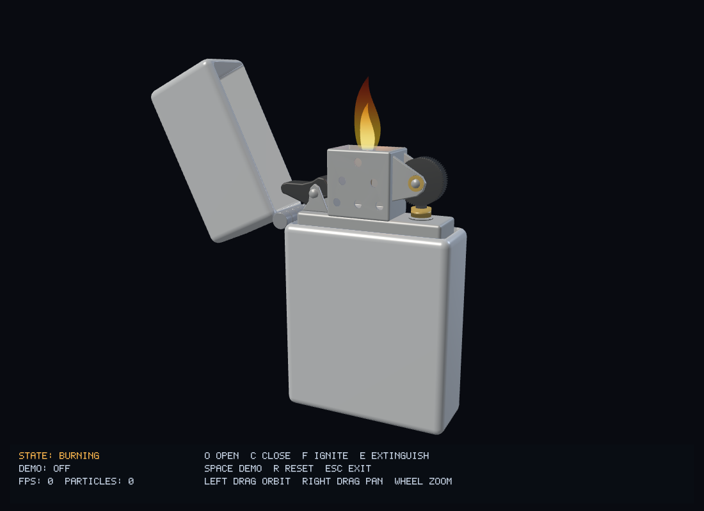

# Lighter3D

基于 C++17 / OpenGL 3.3 Core 的经典翻盖打火机三维交互仿真，按《Lighter3D_设计文档.md》实现。

已实现 FR-01～FR-13 的全部必须项和计划交付项，并提供可选的右键平移与灭火烟雾（FR-14、FR-15）。包含 Blender 源模型、十二个分部件 OBJ、完整状态机、打火轮动画、火花、分层三维火焰、自动演示和屏幕操作提示。

便携程序保留在 `build/Lighter3D-Windows-x64.zip`。解压后运行 `package/Lighter3D.exe`，并保留同目录的 `assets/`、`shaders/`。无需安装 Blender 或 Python 即可运行成品。开发用临时工具、构建缓存和重复运行目录已清理，源码、模型源文件及文档仍然保留。

[验收与实测记录](docs/development.md) · [现场演示步骤](docs/demo.md)



## 操作

| 输入 | 功能 |
| --- | --- |
| O | 平滑开盖至 115°；关盖途中反向；灭火时取消待执行的关盖请求 |
| C | 平滑关盖；点火或燃烧时先灭火再关盖 |
| F | 开盖完成后转轮、产生火花并点燃火焰 |
| E | 灭火并保持上盖打开 |
| R | 立即重置模型、动画、粒子、演示和摄像机 |
| Space | 启动或停止完整自动演示 |
| 鼠标左键拖动 | 水平 360° 环绕与俯仰观察 |
| 鼠标右键拖动 | 平移观察中心 |
| 滚轮 | 拉近或拉远，限制有效范围 |
| Esc | 退出 |

底部屏幕面板显示当前状态、演示步骤、帧率、粒子数量、快捷键和非法操作提示。键盘按下沿触发，忽略长按重复。

自动演示从闭合状态开始，保留当前摄像机视角，依次开盖、点火、持续燃烧、主动灭火、再次点火，最后自动灭火并关盖。再次按 Space 只停止后续步骤，当前动作正常完成。按 O、C、F、E 会先退出演示，再执行手动请求。

窗口最小化时暂停仿真并重置计时基准；失焦取消鼠标拖动。窗口尺寸变化时同步更新投影比例。超过一秒的调试或挂起间隔按暂停处理，正常经过时间使用不超过 1/120 秒的子步推进。

## 标准构建：MSVC

安装 Visual Studio 2022 Build Tools 的“使用 C++ 的桌面开发”（包括 MSVC 和 Windows SDK）、CMake 3.24+、Python 3。VS Code 扩展建议及调试入口位于 `.vscode/`。

```powershell
python -m pip install Jinja2==3.1.6 MarkupSafe==3.0.3
cmake --preset msvc
cmake --build --preset debug
ctest --preset debug
& ./build/msvc/bin/Debug/Lighter3D.exe
```

Release 构建与便携打包：

```powershell
cmake --build --preset release
ctest --preset release
cmake --install build/msvc --config Release --component Runtime --prefix build/package
& ./build/package/Lighter3D.exe
```

首次配置需要联网下载依赖。GLFW 3.4、GLM 1.0.1、GLAD 2.0.8、Assimp 5.4.3 的版本和源码包 SHA-256 均固定。GLM 使用头文件模式，Assimp 仅启用 OBJ 导入，GLAD 根据自带规范生成 OpenGL 3.3 Core 加载器，不包含额外扩展。

如果 CMake 选中的 Python 不能导入 Jinja2，在配置时指定 `-DPython_EXECUTABLE=实际的python.exe路径`。MSVC 及各依赖统一使用静态运行库。GPU 资源在 OpenGL 上下文销毁之前释放。

本机尚未安装 MSVC，因此上述 MSVC 预设和 VS Code 调试尚未实测；开发阶段已实际验证 MinGW 的 Debug、Release 构建及运行，结果见验收记录。

## MinGW 构建

开发阶段使用 CMake 3.31.8、Ninja 1.12.1、GCC 16.2.0 和 Blender 4.5.3。项目内下载的便携工具已经清理；重新构建时需自行准备 CMake、Ninja、GCC/G++ 和 Python，并保证命令可从 PATH 找到。Python 模块要求与标准构建相同。

```powershell
cmake -S . -B build/local -G Ninja -DCMAKE_C_COMPILER=gcc -DCMAKE_CXX_COMPILER=g++ -DCMAKE_BUILD_TYPE=Release
cmake --build build/local --parallel 6
ctest --test-dir build/local --output-on-failure
cmake --install build/local --component Runtime --prefix build/package
& ./build/package/Lighter3D.exe
```

需要 Debug 时，使用单独的构建目录并将 `CMAKE_BUILD_TYPE` 设为 `Debug`。构建目录已加入忽略规则，可以随时重新生成。

模型与 Shader 每次构建同步到程序目录；程序始终从可执行文件目录定位资源，可从其他工作目录启动。不要在重建前继续运行同一路径的旧程序，否则 Windows 会锁定 EXE。

## 验证

以下命令在重新构建后执行；也可以对解压后的便携程序使用相同的验证参数。

```powershell
ctest --test-dir build/local --output-on-failure
& ./build/local/bin/Lighter3D.exe --smoke-test
& ./build/local/bin/Lighter3D.exe --benchmark
& ./build/local/bin/Lighter3D.exe --endurance-test
```

- `LighterStateTests`：七种状态输入矩阵、点火时序与取消、先灭火后关盖、中途反向、重置、不同时间步、完整演示、10 万次随机操作。
- `EffectsTests`：固定容量粒子池、运动与回收、重置、摄像机边界、仿真事件顺序及加速推进的 600 秒循环。
- `--smoke-test`：创建隐藏的真实 GLFW/OpenGL 窗口，绘制模型及特效各状态，检查输入回调、演示中断、全局重置、窗口尺寸变化和 OpenGL 错误，输出十三张 BMP 到可执行文件目录，该目录须可写。
- `--benchmark`：1920×1080、关闭垂直同步，预热 60 帧后测量 600 帧燃烧和环绕场景。该结果不等于启用垂直同步时的显示帧率，也不是其他电脑的性能承诺。
- `--endurance-test`：1920×1080 隐藏窗口实际连续运行十分钟，反复完整演示并环绕，检查状态约束、粒子容量和 OpenGL 错误。

仅测试状态机和演示控制器，无需下载图形依赖：

```powershell
cmake -S . -B build/logic -DLIGHTER_BUILD_APP=OFF
cmake --build build/logic --config Debug
ctest --test-dir build/logic -C Debug --output-on-failure
```

## Blender 模型

`assets/source/lighter.blend` 保存源模型，`assets/models/` 包含机身、上盖、内胆、防风罩、固定铰链、活动铰链、打火轮、支架、火石、灯芯、黑色凸轮及黄铜导管与衬套。机械布局按提供的参考照片调整为左侧黑色凸轮、中间防风罩、右侧打火轮，火石与黄铜导管在轮子正下方。防风罩采用 1-2-3 错列通孔，打火轮有真实齿纹，凸轮随开合动作转动。

```powershell
blender --background --python assets/source/create_lighter.py
blender --background --python-exit-code 1 assets/source/lighter.blend --python assets/source/validate_lighter.py
```

建模脚本导出三角面和角法线，显式把 Blender 的 Z 向上坐标转换为程序的 Y 向上、正面 +Z 坐标，所有部件保留共同装配坐标，不分别居中或归一化。验证脚本检查闭合网格、有限坐标、通风孔贯通情况及上盖每隔 1° 的运动净空。

铰链轴心、打火轮轴心和灯芯锚点集中在 `include/Assembly.h`；对应模型位置也保存在 Blender 场景属性中，修改建模参数时需同步。所有模型均由本项目脚本制作，没有使用外部模型或纹理。

## 代码结构

| 模块 | 职责 |
| --- | --- |
| Lighter / Animation | 七状态控制、平滑插值、点火时间线、一次性事件与取消 |
| DemoController | 复用手动动作接口，按状态和停留时间推进演示 |
| Simulation | 以小时间步协调状态机、事件、固定容量粒子池与重置 |
| Camera | 环绕、缩放、平移及视角边界 |
| Model / Shader | Assimp 静态网格导入、GPU 资源及 Shader 错误报告 |
| Renderer | 装配、枢轴变换、材质差异和 Blinn-Phong 光照 |
| EffectsRenderer | 两层三维火焰、随视角排序、透明混合、火花和烟雾 |
| Hud | 简单字形显示状态和操作说明，不引入 GUI 或字体依赖 |
| main.cpp | GLFW 生命周期、键鼠回调、主循环和验证入口 |

火焰使用 GLSL 动态变形，根部固定、顶部摆动并轻微改变高度；内外层颜色区分亮芯、外焰和根部蓝色。燃烧时额外暖色点光照亮附近金属。透明对象保留深度测试、关闭深度写入，绘制后恢复状态。火花最多 64 个、烟雾最多 24 个，GPU 缓冲在初始化时创建，渲染中只更新数据。

本项目按设计范围采用简化金属光照、网格火焰和点粒子；未扩展燃料消耗、流体、工业机械精度、PBR 或实时阴影。

## 第三方来源

[GLFW](https://www.glfw.org/)、[GLM](https://github.com/g-truc/glm)、[GLAD](https://github.com/Dav1dde/glad)、[Assimp](https://github.com/assimp/assimp)。许可声明保存在 `docs/licenses/`，安装到便携目录的 `licenses/`。
