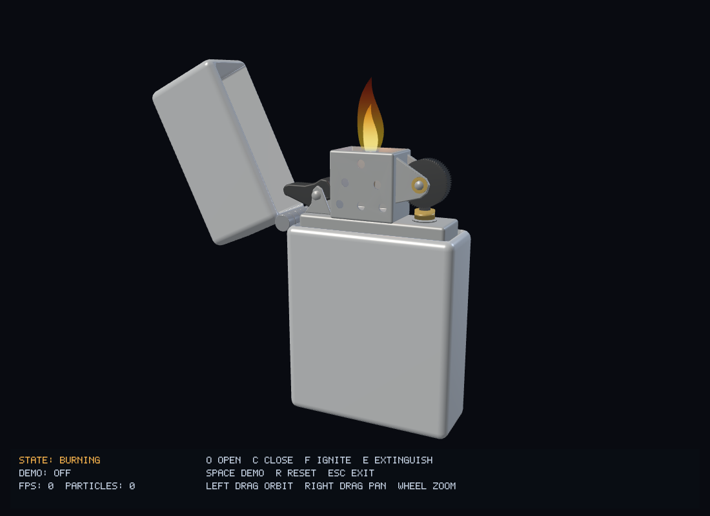
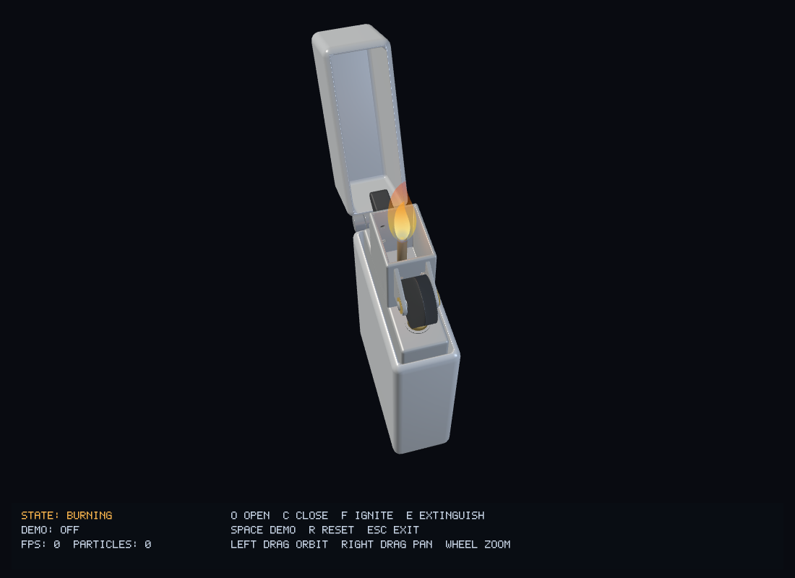
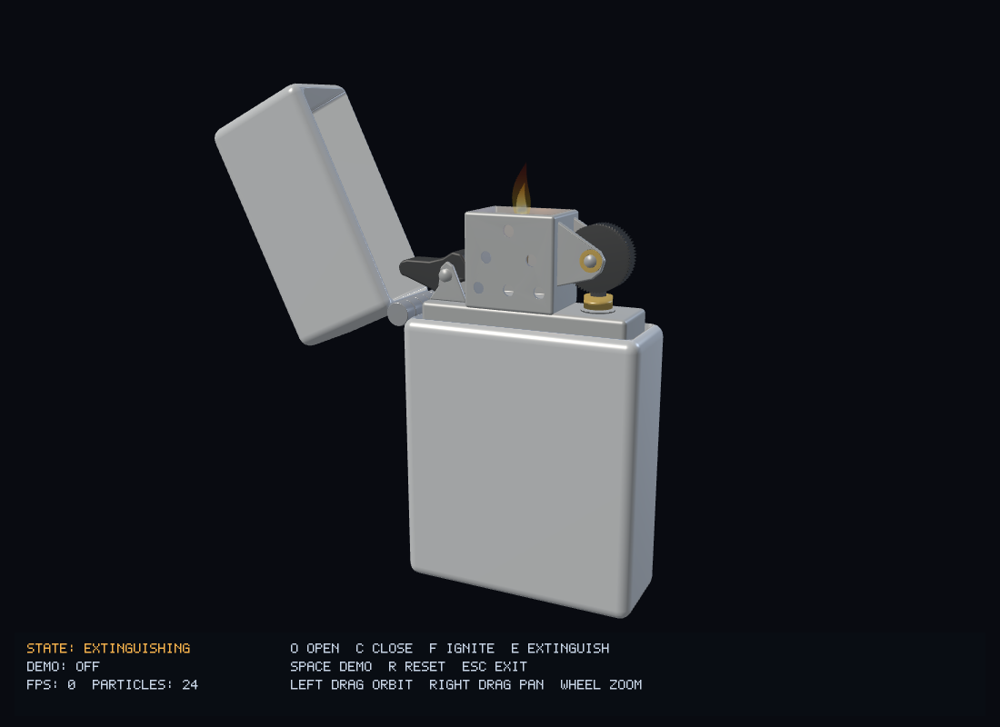
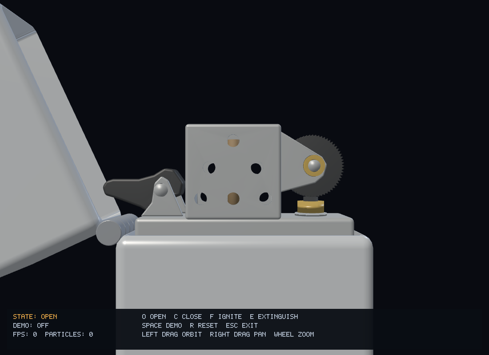

# 开发与验收记录

日期：2026-11-10。依据根目录《Lighter3D_设计文档.md》，在首个原型基础上完成其余零件、状态机、火花、动态火焰及完整演示。原设计文档保持不变，实际结果记录在此。

## 功能覆盖

| 需求 | 实现 |
| --- | --- |
| FR-01 三维模型 | 十二个 OBJ：机身、上盖、内胆、防风罩、两组铰链、打火轮、支架、火石、灯芯、凸轮及黄铜导管与轴套 |
| FR-02 / FR-03 开合 | 铰链枢轴变换，115° / 0°，0.5 秒完整行程；反向时保持位置并调整剩余时长 |
| FR-04 打火轮 | 绕自身 Z 轴枢轴快速转动，点火前 0.18 秒内旋转，之后保持当前角度 |
| FR-05 点灭火 | 七状态机、合法动作判断、点火取消、主动灭火、延迟关盖与取消延迟关盖 |
| FR-06 动态火焰 | 两层三维截面网格、亮芯与外焰、根部蓝色、随高度加强的摇曳、点燃生长和熄灭收缩 |
| FR-07 / FR-08 观察 | 水平环绕、限制俯仰、限制缩放 |
| FR-09 重置 | 状态、盖角、轮角、事件、火焰、粒子、演示计时及摄像机一起复位 |
| FR-10 金属材质 | Blinn-Phong，外壳与内部金属、深色轮子和非金属灯芯具有不同材质参数 |
| FR-11 火花 | 约 0.08 秒的一次性爆发，固定 64 个粒子，寿命衰减、重力、加法混合 |
| FR-12 自动演示 | 完整两次点火流程，按状态推进；支持停止、手动打断并保留摄像机 |
| FR-13 提示 | 屏幕 HUD 与窗口标题显示状态、快捷键、演示步骤和非法操作提示 |
| FR-14 平移（可选） | 右键拖动平移观察中心，限制平移范围 |
| FR-15 烟雾（可选） | 灭火时生成最多 24 个上升、扩散并淡出的点粒子 |

没有增加燃料、流体、PBR、物理碰撞求解或其他超出设计范围的功能。静态模型直接合并 GPU 缓冲，操作提示用小字形 HUD 实现，不另加场景图、纹理加载器或 GUI 依赖。

## 构建与逻辑验证

| 项目 | 实测结果 |
| --- | --- |
| 平台 | Windows；Intel Iris Xe Graphics；OpenGL 3.3.0，驱动 Build 30.0.101.1934 |
| 工具 | CMake 3.31.8 / Ninja 1.12.1 / MinGW GCC 16.2.0 / Blender 4.5.3 |
| Release | 构建成功；CTest 2/2 通过；完整 OpenGL smoke test 通过 |
| Debug | 构建成功；CTest 2/2 通过；完整 OpenGL smoke test 通过 |
| 无图形依赖逻辑构建 | LIGHTER_BUILD_APP=OFF 构建成功；状态与演示测试通过 |
| 输入规则 | 七种状态 × 四种机械动作与设计表一致；长按重复事件被忽略 |
| 点火时间线 | 转轮先行、0.08 秒一次火花、0.15 秒后生长、0.4 秒进入 Burning |
| 中断 | 在 0、0.04、0.079、0.081、0.149、0.151、0.25、0.399 秒取消点火，均不残留待触发火花或重新冒火 |
| 延迟关盖 | 燃烧中 C 先灭火；灭火中 O 取消延迟关盖；灭火中 C 可追加关盖 |
| 时间步 | 30 / 60 / 144 FPS 和 0.8 秒大时间步通过，灭火到关盖间保留剩余时间 |
| 自动演示 | 两次点火、主动灭火及合盖自动灭火顺序通过，停止后当前动作完成且不再推进 |
| 随机输入 | 10 万次动作、重置和时间推进，未违反盖角、火焰和状态约束 |
| 粒子 | 最大 64 火花 + 24 烟雾，重复生成不扩容；寿命回收、运动和清理通过 |
| 摄像机 | 俯仰、缩放与平移极限无非有限值；重置恢复初始位置 |
| 加速耐久测试 | 600 秒仿真时间、多次完整演示，状态和粒子容量约束通过 |

## 几何与渲染验证

- 十二个 OBJ 共 10370 个三角形；三角化、封闭边拓扑、有限坐标和单位法线检查通过。
- Blender 验证脚本从 0° 到 115°、每隔 1° 扫描上盖、随开合运动的黑色凸轮与固定内部零件，未发现表面相交。该检查用于模型净空验证，运行时不执行物理碰撞计算。
- 六条穿过前后壁通风孔中心的射线均贯通，孔间实体壁检查通过。防风罩使用真实布尔孔洞。
- 上盖和活动铰链共用轴心 (-0.94, 0.565, 0)、轴向 +Z；打火轮轴心 (0.50, 1.035, 0)、轴向 +Z；火焰根部固定在灯芯位置 (-0.08, 1.235, 0)。
- 真实 OpenGL 检查覆盖闭合、开盖、火花、点燃、燃烧、背面、上方、下方、灭火、烟雾、关盖，以及 800×600 尺寸变化；各次绘制后 glGetError 为 0。
- 调用了实际注册的键盘处理函数，验证闭盖 F 的提示、GLFW_REPEAT 忽略、演示中手动退出、R 完整重置。
- 已检查开盖、燃烧、关盖、正面机械特写和上下方等关键截图，检查部件装配、通孔、火焰遮挡、灭火收缩及提示文字。Windows 窗口自动化实测了闭盖提示、左键环绕、滚轮缩放、R 复位、O/F/E 操作、Space 演示及 C 关盖；燃烧中最小化后恢复和最大化显示正常。
- 火焰根据当前变形后顶点在观察空间中的深度排序三角形，烟雾按深度排序；透明阶段关闭深度写入，火花使用加法混合，最后恢复渲染状态。

## 参考图结构修正

按提供的参考照片，将打火轮移至防风罩右侧，火石与黄铜导管对准轮底接触点；左侧新增黑色凸轮、银色支架与转轴。轮轴支架改为三角轮廓并加入黄铜衬套，防风罩孔位改为 1-2-3 错列排列。火花起点、飞散方向和灯芯锚点同步调整。凸轮由闭盖时 -65° 转到开盖时 0°，与盖角同步，未增加状态机。

黑色拨片进一步改为圆角长柄，轴心至左端距离由约 0.28 增至 0.45（增加约 60%），支架与转轴保持原位。闭盖收纳角调整为 -65°，避免延长后穿过上盖。此次模型导出仅 cam.obj 的几何内容变化。

本次通过 0°～115° 每隔 1° 的上盖与凸轮联合净空扫描、通孔贯通检查、逻辑测试和实际 OpenGL 渲染检查。

## 性能与连续运行基线

下列性能与连续运行结果属于本次参考图改模前的功能基线；本次改模未重复十分钟测试。

Release、隐藏 GLFW 窗口、1920×1080、关闭垂直同步：预热 60 帧后，对 600 帧持续燃烧、三角排序、HUD 与环绕场景测得约 **385.7 FPS**。测量包含帧更新和绘制，并在计时末尾等待 GPU 完成。该值仅描述本机这组测试，不保证其他硬件或场景的帧率；正常窗口启用垂直同步。

改模前基线构建已完成 **600 秒真实时间连续运行、63 次完整演示**，退出码 0，未出现状态卡死、OpenGL 错误或粒子超限。每 30 秒采样进程私有内存，排除启动与退出采样后为 **97.39～97.96 MiB**，未见持续增长。日志与内存样本位于 [validation/](validation/endurance.txt)。该日志对应改模前的二进制，不能作为当前改模版本的十分钟实测结果。

便携交付已从系统临时目录启动并通过完整渲染检查。临时移除防风罩 OBJ 和注入无效火焰 Shader 的错误场景均得到明确诊断与退出码 1，测试后已恢复。成品只依赖 Windows 系统 DLL。

## 对设计文档 22 项验收的对应

- [ ] VS Code + CMake + MSVC 编译运行：本机没有 MSVC，已提供配置，尚未实测。
- [x] OpenGL 3.3 Core 窗口。
- [x] 摄像机和基础光照（逻辑与渲染检查）。
- [x] 机身、上盖及闭合接缝。
- [x] 铰链位置、轴线及开盖净空。
- [x] 内胆、防风罩及打火轮展示。
- [x] 平滑开启及目标端点。
- [x] 平滑关闭及闭合端点。
- [x] 打火轮枢轴旋转。
- [x] 完整点火流程。
- [x] 一次性短暂火花。
- [x] 持续动态火焰。
- [x] 主动灭火。
- [x] 合盖先灭火再关闭。
- [x] 环绕与俯仰（逻辑与实际鼠标拖动验证）。
- [x] 缩放边界（逻辑与实际滚轮验证）。
- [x] R 完整重置。
- [x] 摄像机与动画独立推进。
- [x] 完整演示及正常停止。
- [x] 各状态输入规则。
- [x] 十分钟实际运行稳定性：改模前基线的 600 秒、63 次完整演示通过；本次仅重跑建模与功能检查。
- [x] 截图、现场演示步骤与运行说明。

功能开发已经覆盖设计的全部功能项。MSVC / VS Code 工具链在本机不可用，不提前标记为完成验证。
